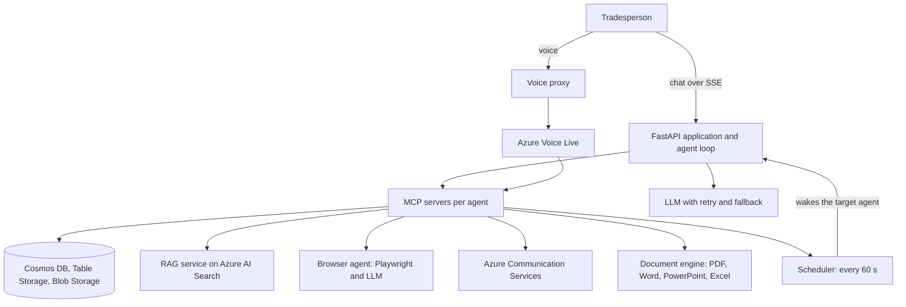

# Faktavik

A team of six AI agents that runs the back office of small construction businesses: quotes, invoices, projects, purchasing, hiring. In production on Azure. Website: [faktavik.online](https://faktavik.online)

> The source code is private. This repository explains how the platform is built and why.

**My role:** CTO. The platform was designed and built under my leadership.

**Scale:** 75,000+ lines of code, 6 AI agents, 189 business tools, $150,000 in Azure credits from Microsoft for Startups.

## Architecture

## Hard problems solved

### Agents that finish the job

An LLM tends to stop after one step. Here the agent writes a task list, and the server keeps relaunching it while tasks remain, with the current list injected at each turn. Four guards bound the loop: a maximum number of automatic continuations, a stop when no task progressed, a stop when an action needs human confirmation, and a stop when the client disconnects.

### Work that outlives the conversation

A supplier search takes minutes, and an SSE stream dies when the user leaves the screen. Long work therefore follows one pattern: a persistent case file, an immediate reminder picked up by the scheduler, a tracking screen, and user decisions that wake the agent again. The case file is the source of truth and the conversation is only the thread around it. During a search, the browser agent posts each readable step back to the case, so the user watches it happen live.

### Never losing a tool result

An agent generated seven images, and the conversation history kept one. The history was only saved when the stream ended, so an interrupted long turn lost everything. Now:

- history is saved after every tool result and again in a `finally`;
- a partial snapshot is made valid by keeping only the tool calls that have answers;
- malformed tool arguments from the model become a tool error instead of an orphan call;
- URLs produced by tools are pinned in memory, so the agent cannot lose or invent them when the context is trimmed.

### A list tool that returned one item

The agents kept finding a single supplier. The FastMCP SDK serializes a returned `list` as N separate content blocks without `structuredContent`, and the client read only the first block. The sort order made it worse: the one item seen was always the most recent, so it looked plausible. The client now aggregates all blocks. This affected every list tool on the platform.

### A browser agent that handles real merchant sites

Reading supplier prices means picking a local branch, passing cookie banners and using sites with no ARIA roles. The agent's page digest puts stable attributes on visible elements, so an action cannot hit a shifted index. It restricts itself to the open modal layer, detected through position, z-index and surface. It exposes only text fields. Hard limits are coded rather than requested: payment fields are refused, and a CAPTCHA stops the mission with a report.

### Importing thousands of rows

A 3,000-client file imported about 15 rows, because the text was cut before a single AI call whose output was truncated. The pipeline now has two paths:

- CSV and Excel are parsed directly through column mapping, with no AI and no row limit;
- PDFs and images go through Document Intelligence, then AI structuring in concurrent batches with deduplication.

Truncated JSON is recovered by scanning balanced braces. Entities are created in concurrent batches, and a guard keeps the import job under the Cosmos DB 2 MB document limit. This work also uncovered a quiet data loss: a wrong field name that Pydantic simply ignored was dropping every client's address.

### Staying up when the model is rate limited

Calls go through a single wrapper with backoff on 429, 5xx and network errors, and an immediate switch to a fallback deployment. The fallback has to sit in a separate quota bucket: two model variants hosted by the same provider share one quota and fail together. Provider-specific parameters are removed on the switch, because they cause a 400 on another model. The context is bounded to a summary plus the last exchanges.

## Design decisions

- **One set of tools for chat and voice.** Voice sessions connect to the same MCP servers as text agents, so both channels do the same work.
- **Agents hand work to each other.** A live transfer moves a conversation; a scheduled reminder assigned to another agent passes work asynchronously. Every action goes to a journal, and open work must have a next step scheduled.
- **Behavior is data.** Prompts and per-agent procedures live in the database and can be edited per account, with defaults in the code.
- **Human confirmation on sensitive actions.** The agent prepares and the tool call waits for the user.
- **Email images are embedded.** A/B testing showed that a remote image sent mail to spam at Microsoft, so logos go inline through `cid:`.
- **HTML to PDF for design quality.** Eight document designs are rendered with WeasyPrint.

## Stack

Python, FastAPI, MCP, Azure Container Apps, Azure AI Foundry, Azure AI Search, Azure Voice Live, Document Intelligence, Azure Communication Services, Cosmos DB, Azure Table Storage, Blob Storage, Playwright, WeasyPrint, Key Vault, Azure DevOps
