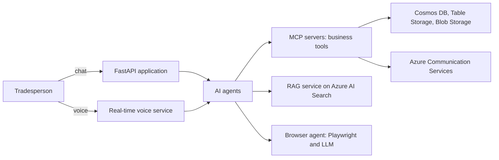

# Faktavik

AI agent management platform for small construction businesses. In production on Azure. Website: [faktavik.online](https://faktavik.online)

> The source code is private. This repository documents the product and its architecture.

**My role:** CTO. The platform was designed and built under my leadership.

## At a glance

- 75,000+ lines of code
- 6 AI agents and 189 business tools
- $150,000 in Azure credits from Microsoft for Startups

## Architecture

## Engineering decisions

- **One set of tools for chat and voice.** Voice sessions connect to the same MCP servers as text agents, so both channels can do the same work.
- **Long tasks run in the background.** An agent can hand a long search to a scheduler and call the user back when it is done.
- **Agents hand work to each other.** Scheduled reminders and transfers carry a task from one agent to the next, and every action goes into a log.
- **Conversation history is saved turn by turn,** so tool results survive an interrupted stream.
- **Secrets live in Key Vault only,** and every push to the main branch goes through Azure DevOps CI/CD.

## What it does

- Quotes, invoices, Word, PowerPoint and Excel documents in the client's branding
- A website for each client
- Bulk data import from CSV, Excel and scanned documents (Document Intelligence)
- Supplier price comparison with a browser agent

## Stack

Python, FastAPI, Azure Container Apps, Azure AI Foundry, Azure AI Search, Voice Live, Document Intelligence, Cosmos DB, Azure Table Storage, Azure Communication Services, Key Vault, Azure DevOps
